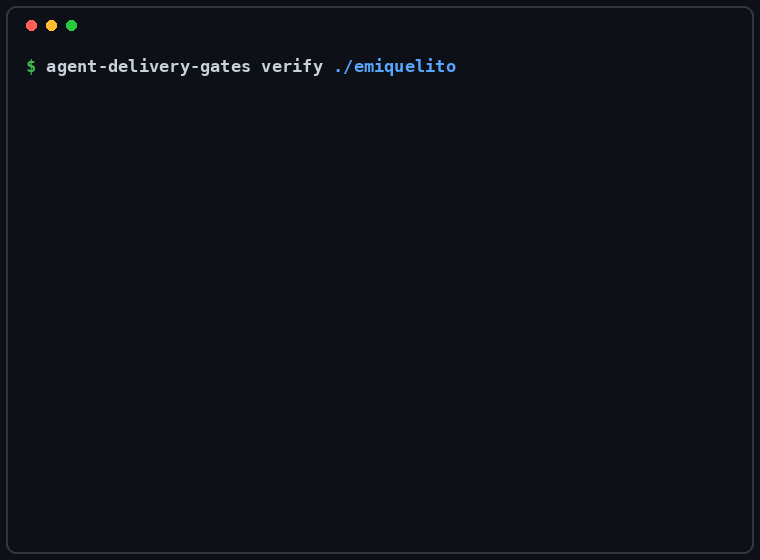

### I build the part that says no



#### [agent-delivery-gates](https://github.com/emiquelito/agent-delivery-gates) · [agentgates.dev](https://agentgates.dev)

Fourteen proof obligations for what an AI coding agent claims about its own work. Five are
enforced by a git hook on every commit. It breaks code on purpose and reports the breaks no
test noticed, runs a change's new tests against the code from before the change, and induces a
declared failure once with the error handling in place and once with it removed, rejecting the
claim when the check passes both times.

#### [tailkeep](https://github.com/emiquelito/tailkeep)

A Go application that keeps secrets and sensitive data in prompts off cloud LLMs. It runs on a
tailnet and uses Tailscale identity to decide, per person, whether to allow a prompt, redact
it, block it, or answer it with a local model. No API keys. Built with `tsnet`.

```
  Programming   no favourites, several grudges
    Languages   English, Portuguese, Mineiro Portuguese
   Obsessions   gardening, traveling, cooking,
                golden retrievers, explaining pão de queijo
Lines of code   ∞
    Exit code   1 (favourite)
```

[linkedin.com/in/emiquelito](https://linkedin.com/in/emiquelito) · emiquelito@gmail.com
